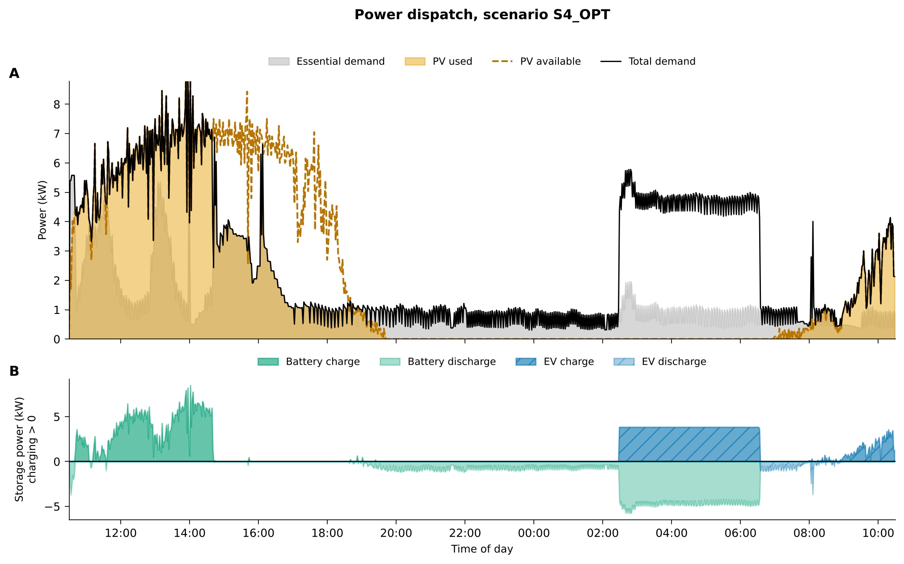
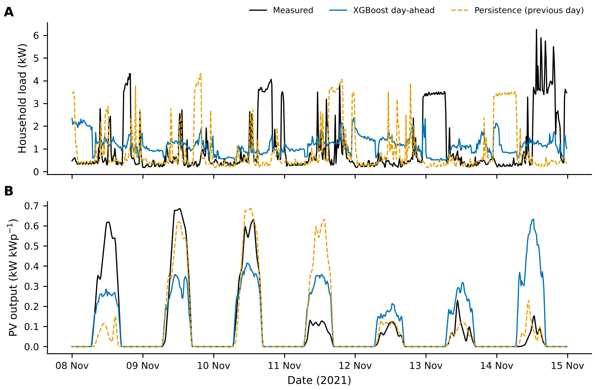
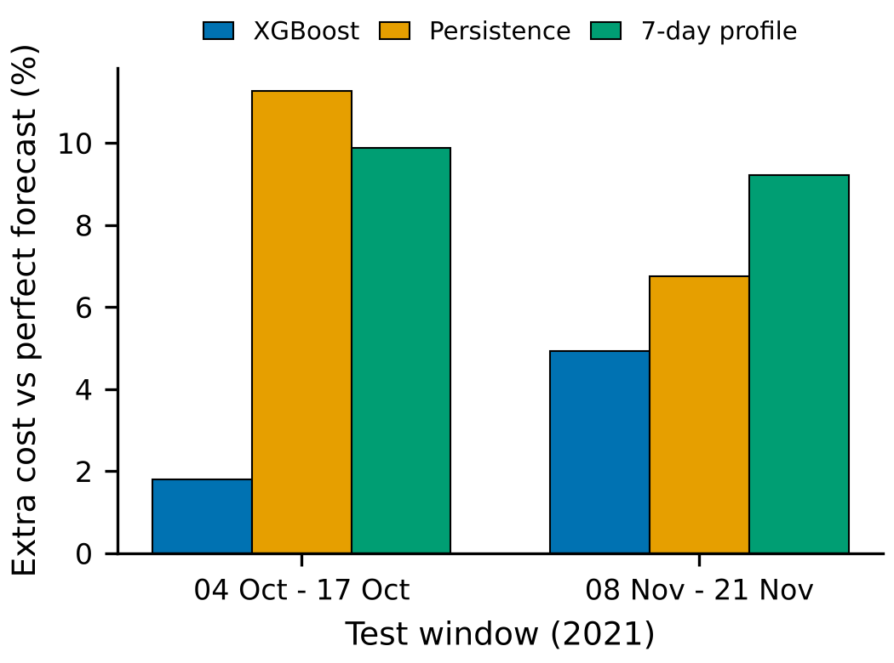
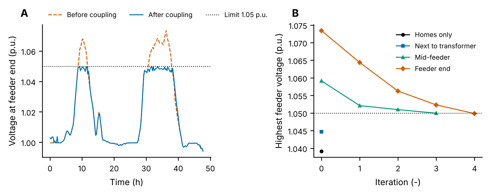
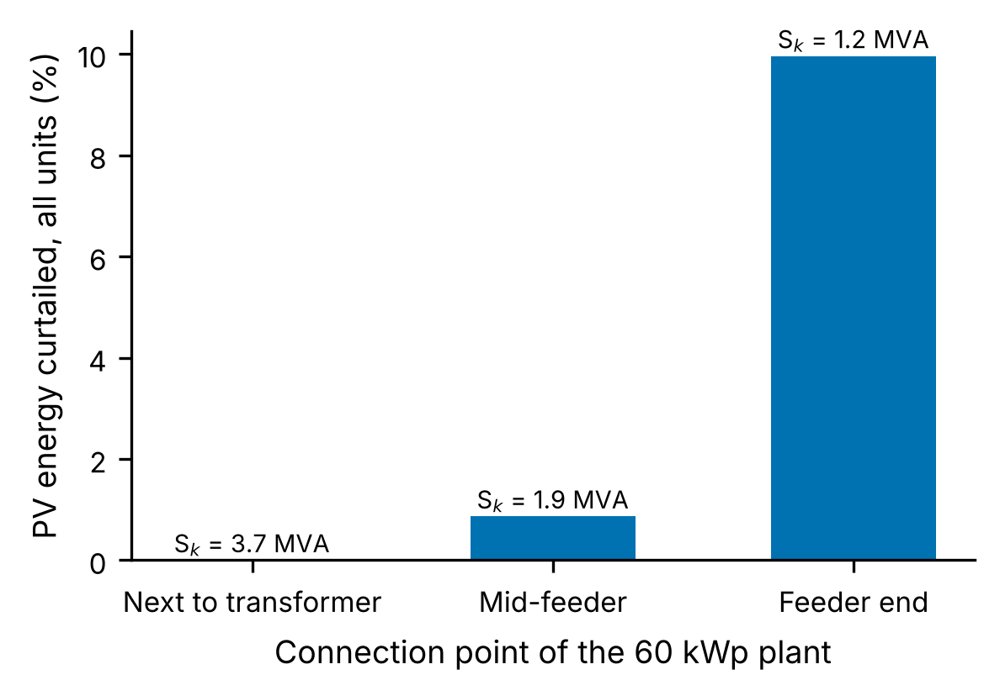

# Residential Microgrid Energy Management: MILP Control, Planning, Sizing, Forecast-Driven MPC and Grid Coupling

Energy management for a single home with rooftop PV, a stationary battery, a bidirectional EV charger, a heat pump, a backup genset and a grid connection. The repository covers four levels of the problem, from a single home to a low-voltage feeder:

| Part | Question | Method | Time step / horizon |
|---|---|---|---|
| 1. Real-time control | How should the assets be dispatched minute by minute? | Rule-based controller vs single-step MILP controller | 1.5 min, 24 h, 4 scenarios |
| 2. Planning and sizing | What does a year of optimal operation cost, and what system size minimises total cost? | Annual MILP (planning) and LP (sizing, CAPEX + OPEX) | 15 min, up to 1 year |
| 3. Forecasting and MPC | How much does forecast quality cost in practice? | XGBoost day-ahead load and PV forecasts feeding a day-ahead MILP with a real-time correction layer | 15 min, rolling daily |
| 4. Grid coupling | Is the optimised dispatch feasible on the feeder, and where should a larger PV plant connect? | Pyomo dispatch coupled iteratively with AC load flow in pandapower; short-circuit power and reinforcement check | 15 min, 2 days |

Parts 1 and 2 are the group coursework of the DENSYS M1 module on microgrids (Université de Lorraine). Parts 3 and 4 are extensions written afterwards.

All models are written in Pyomo and solved with the open-source HiGHS solver, so no commercial licence is needed.

---

## Quick start

```bash
pip install -r requirements.txt

# Part 1: real-time control, one scenario (about 5 s each)
cd part1_realtime_control
python rule_based.py S4
python milp_controller.py S4
python compare_controllers.py          # all scenarios, writes results/part1_controller_comparison.csv

# Part 2: planning and sizing (argument = number of days, default 365)
cd ../part2_planning_sizing
python planning.py 7                   # about 10 s; a full year takes several minutes
python sizing.py 7

# Part 3: forecasting then MPC
cd ../part3_forecast_mpc
python forecasting.py                  # about 3 s
python mpc.py                          # two 14-day windows, about 40 s
python mpc.py 2021-12-01 7             # any other window

# Part 4: optimisation coupled with load flow on a low-voltage feeder
cd ../part4_grid_coupling
python grid_coupling.py                # two summer days, about 90 s

# All results in one formatted Excel workbook
cd ..
python export_excel.py                 # writes results/microgrid_results.xlsx
```

Another Pyomo solver can be selected with the `MICROGRID_SOLVER` environment variable (for example `MICROGRID_SOLVER=gurobi`). Parts 1 and 2 use it through `SolverFactory`, part 3 as well.

---

## Repository layout

```
data/
  realtime/        Load, PV, EV, heat loss and set-point profiles for the four part 1 scenarios
  annual/          annual_profiles_2021.csv, 15-min profiles for one year (load, PV, EV, P_loss, T_set)
part1_realtime_control/
  simulator.py     plant simulation loop, calls a controller every step
  rule_based.py    priority-based controller
  milp_controller.py  single-step MILP controller with weighted objective
  compare_controllers.py
  plotting.py, param.py
part2_planning_sizing/
  planning.py      annual operation MILP for a fixed system
  sizing.py        joint sizing and operation LP
  utils.py, param.py
part3_forecast_mpc/
  forecasting.py   XGBoost day-ahead forecasts and baselines
  mpc.py           forecast-driven day-ahead MPC with real-time correction
  figures/
part4_grid_coupling/
  grid_coupling.py dispatch optimisation coupled with pandapower load flow, siting study
  figures/
results/           CSV outputs and microgrid_results.xlsx
export_excel.py    collects every CSV in results/ into one formatted workbook
```

## Outputs

Every script writes its numbers to `results/` as CSV, and `export_excel.py` gathers them into `results/microgrid_results.xlsx`: a contents sheet, one sheet per summary table (controller comparison, planning and sizing summaries, forecast metrics, MPC costs) and the 15-minute time series. Part 2 writes `part2_planning_*.csv` and `part2_sizing_<case>_*.csv` for whatever horizon it was run on; the shipped workbook only holds parts 1 and 3, so run part 2 for a full year on your own machine to add its sheets. Figures are saved in each part's `figures/` folder.

---

## Part 1: real-time control

The plant runs for 24 h at 1.5-minute resolution (961 steps). At every step a controller receives the current load, PV availability, heat loss, temperature set-point and EV state, and returns set-points for the battery, EV charger, heat pump and genset.

**Rule-based controller.** A fixed priority order: PV serves the load and the heat pump first, the surplus charges the EV and then the battery, and deficits are covered by the battery, then the EV (vehicle-to-home, only above a reserve), then the genset.

**MILP controller.** At each step a small MILP minimises a weighted cost of load shedding, genset fuel, battery and EV discharge, PV curtailment, EV charging shortfall and a small cycling penalty. Constraints cover the power balance, SOC-dependent power limits, a genset on/off binary, and binaries that prevent simultaneous charging and discharging of the battery and the EV. The heat pump keeps the rule-based logic, so the comparison isolates the electrical dispatch.

Results over the four scenarios (`results/part1_controller_comparison.csv`):

| Scenario | Controller | Genset (kWh) | True cost (€) | EV SOC at departure (%) |
|---|---|---|---|---|
| S1 | Rule-based | 0.0 | 0.00 | 63.8 |
| S1 | MILP | 0.0 | 0.00 | 70.6 |
| S2 | Rule-based | 0.0 | 0.00 | 72.4 |
| S2 | MILP | 0.0 | 0.00 | 81.1 |
| S3 | Rule-based | 0.0 | 0.00 | 34.7 |
| S3 | MILP | 9.4 | 2.82 | 50.1 |
| S4 | Rule-based | 0.0 | 0.00 | 34.1 |
| S4 | MILP | 0.0 | 0.00 | 57.5 |

The MILP controller delivers a fuller EV at departure in every scenario. In S3 (low PV) it does this by running the genset for 9.4 kWh, which the rule-based controller never does, so it trades fuel cost for meeting mobility needs.



---

## Part 2: annual planning and sizing

**Planning (`planning.py`).** A MILP over up to 35,040 quarter-hours with a fixed system (10 kWp PV, 40 kWh battery, 10 kW genset). It minimises import cost plus genset fuel minus export revenue, subject to:

- power balance at every step;
- battery and EV energy balances with charge and discharge efficiencies, SOC bounds and binaries against simultaneous charging and discharging;
- EV only usable while plugged in, SOC reset to the arrival value, and a minimum SOC at each departure;
- a first-order thermal model of the house, with the indoor temperature kept within a band around the set-point;
- genset on/off and start-up binaries with minimum and maximum output.

**Sizing (`sizing.py`).** The same operational constraints, with PV, battery, inverters and genset capacities as decision variables. The objective is CAPEX scaled to the simulated period plus OPEX. Four cases are included: base case, isolated microgrid, unpaid export, and a CAPEX budget.

Full-year results reported in the coursework (originally solved with Gurobi):

| | Base case | Isolated | Export not paid | CAPEX budget |
|---|---|---|---|---|
| PV (kWp) | 20.95 | 21.06 | 15.03 | 18.58 |
| Battery (kWh) | 49.59 | 59.14 | 48.46 | 46.99 |
| Genset (kW) | 0 | 3.57 | 0 | 0 |
| Total annual cost (€/yr) | 4,368 | 5,838 | 4,692 | 4,383 |

The scripts in this repository reproduce the formulation with HiGHS. One correction was made while porting: in the original model the battery and EV could exchange power at time index 0, which only holds the initial state, so one step of energy came for free. Those flows are now fixed to zero, which changes the annual figures by a negligible amount. Short horizons (for example 7 days) solve in seconds; a full year takes several minutes.

---

## Part 3: XGBoost forecasting and forecast-driven MPC

### Day-ahead forecasting (`forecasting.py`)

Forecasts are issued at midnight for the next 96 quarter-hours of household load and PV output per kWp. Every feature looks back at least one full day, so nothing from the forecast day leaks into the inputs.

- **Features:** time of day (sine and cosine), day of week, weekend flag, the same quarter-hour on each of the previous 7 days with their mean and standard deviation, the previous day's mean and maximum, and the maximum of the same quarter-hour over the last 14 days.
- **PV target:** PV is learnt as a fraction of that 14-day maximum (a clear-sky proxy) and multiplied back. This removes most of the seasonal level, which tree models cannot extrapolate into unseen months.
- **Split (chronological):** train mid-January to August, validation in September for early stopping, test October to December. The test months are never used for training or tuning.
- **Baselines:** persistence (same time yesterday) and a 7-day same-quarter-hour average.

Test-set accuracy, 1 Oct to 31 Dec 2021 (`results/part3_forecast_metrics.csv`):

| Target | Model | MAE | RMSE |
|---|---|---|---|
| Load (kW) | **XGBoost** | 0.976 | **1.268** |
| | Persistence | 1.105 | 1.741 |
| | 7-day profile | 0.972 | 1.310 |
| PV (kW/kWp) | **XGBoost** | 0.062 | **0.119** |
| | Persistence | 0.059 | 0.135 |
| | 7-day profile | 0.060 | 0.122 |

XGBoost has the lowest RMSE for both targets (27% lower than persistence for load, 12% for PV), meaning fewer large misses. Its MAE is close to the simple baselines. That is expected for a single household, whose load is dominated by short, hard-to-predict appliance spikes, and for PV without any weather forecast input.



### Forecast-driven MPC (`mpc.py`)

The part 2 planning MILP becomes the day-ahead layer of a receding-horizon controller:

1. **Day-ahead plan.** Every midnight the MILP is solved over 36 h (24 h committed plus a 12 h look-ahead, so an early-morning EV departure is visible the evening before) using the load and PV forecasts. The battery must end the committed day with at least the energy it started with, so no strategy can spend the battery for free.
2. **Real-time layer.** Every 15 minutes, with the measured load and PV: the heat pump and genset follow the plan; the EV follows its planned power and charges more if its SOC falls behind the planned trajectory; the battery absorbs the forecast error around its planned set-point within its power and SOC limits; any remaining PV surplus charges the EV further. What is left is imported or exported.
3. The measured end-of-day states initialise the next day's plan.

Each forecast strategy is compared with a perfect-forecast benchmark that plans with the measured profiles, on the same days and from the same initial state (`results/part3_mpc_summary.csv`):

| Window (2021) | Strategy | Realised cost (€) | Extra cost vs perfect |
|---|---|---|---|
| 4 to 17 Oct | Perfect forecast | 174.95 | |
| | **XGBoost** | **178.09** | **+1.8%** |
| | Persistence | 194.66 | +11.3% |
| | 7-day profile | 192.21 | +9.9% |
| 8 to 21 Nov | Perfect forecast | 228.70 | |
| | **XGBoost** | **239.94** | **+4.9%** |
| | Persistence | 244.15 | +6.8% |
| | 7-day profile | 249.75 | +9.2% |



Even though XGBoost's average forecast error is close to the baselines, it gives the lowest operating cost in both windows. The cost of a forecast error depends on its size, not only its average: one badly over-forecast sunny day leads the plan to defer imports and schedule EV charging that PV then cannot supply. The lower RMSE is what matters here.

### Limitations

- One household and one year of data; the forecasting test covers a single autumn and winter.
- No weather forecast inputs. Adding irradiance and temperature forecasts is the obvious next step for PV and heat-pump demand.
- The MPC comparison covers two 14-day windows, chosen to keep run times short. Longer runs are possible with `python mpc.py <start> <days>`.
- End-of-window battery and EV states differ slightly between strategies, so on very short windows (one or two days) a forecast strategy can come out marginally cheaper than the perfect-forecast benchmark.
- Heat losses, temperature set-points and EV plug-in times are treated as known in advance.
- The real-time layer is a simple rule set around the plan, not a second optimisation.

## Part 4: coupling the dispatch optimisation with a grid model

Parts 1 to 3 treat the grid as a single connection point with no network behind it. In practice the low-voltage network is often the bottleneck: when many homes export PV at midday, voltage rises along the feeder. Part 4 checks the optimised schedules against a grid model and feeds the violations back into the optimisation.

**Network.** The Kerber "Landnetz Freileitung 1" test feeder from pandapower: a 160 kVA transformer and 13 homes on a 270 m overhead line. Each home has 6 to 12 kWp of rooftop PV, its own load profile (scaled and time-shifted from the annual profile), and every second home has a 10 kWh / 5 kW battery. The window is two sunny days in June 2021.

**Workflow (`grid_coupling.py`).**

1. A Pyomo LP schedules all homes for minimum import cost minus export revenue (prices as in part 2), with per-home, per-time-step export and import limits.
2. Each home's net grid exchange is mapped onto its bus and an AC load flow is run for every 15 minutes.
3. Where a bus exceeds 1.05 p.u., falls below 0.95 p.u., or a line or the transformer exceeds 100% loading, the export (or import) limit of the homes causing it is set to 85% of their flow in those time steps. For an overloaded line these are the homes downstream of it.
4. The LP is solved again, and the loop repeats until the whole schedule is network-feasible.

The same loop then assesses three connection points for a 60 kWp PV plant, alongside the short-circuit power at each point and a reinforcement alternative (NAYY 4x150 cables and a 400 kVA transformer, with the unconstrained schedule).

**Results** (`results/part4_siting.csv`, `results/part4_coupling_iterations.csv`):

| Plant connection point | Short-circuit power (MVA) | Highest voltage before (p.u.) | Steps in violation | Iterations | PV curtailed, all units | Highest voltage if reinforced (p.u.) |
|---|---:|---:|---:|---:|---:|---:|
| No plant (homes only) | | 1.039 | 0 | 0 | 0% | |
| Next to transformer | 3.7 | 1.045 | 0 | 0 | 0% | 1.021 |
| Mid-feeder | 1.9 | 1.059 | 24 | 3 | 0.9% | 1.028 |
| Feeder end | 1.2 | 1.073 | 40 | 4 | 10.0% | 1.035 |

- The homes alone stay within limits, but the same 60 kWp plant is harmless next to the transformer and causes voltage violations in 40 of 192 quarter-hours at the feeder end, where the short-circuit power is three times lower.
- The loop converges in three to four iterations. At the feeder end it curtails 10% of all PV energy over the two days (24% of the plant's own output), and reinforcement removes every violation without curtailment.
- Siting the plant near the transformer avoids both curtailment and reinforcement.



*A: voltage at the end of the feeder with the plant connected there, before and after coupling. B: highest feeder voltage at each iteration for every case.*



### Limitations

- A radial low-voltage feeder, so N-1 contingency analysis does not apply. The same loop would carry over to a meshed transmission model, where outages of single lines are screened for every scenario.
- The feedback rule is a heuristic: it tightens limits only where violations occur and can over-curtail slightly. Voltage sensitivities or a linearised power flow inside the optimisation would give a sharper result.
- Unity power factor; reactive-power control by the PV inverters, a cheap alternative to curtailment, is not modelled.
- The MV grid strength (100 MVA short-circuit power) is assumed, and only two summer days are simulated.

---

## Data

All profiles are representative, not measurements from a specific home. Load is a normalised annual profile scaled to 10,000 kWh/yr, PV is given per kWp of installed capacity, and EV availability and arrival SOC are derived from driving profiles scaled to 20,000 km/yr.
